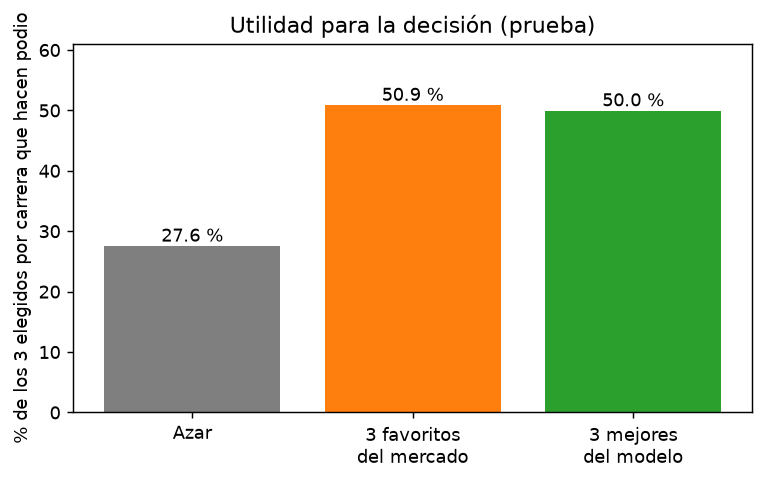
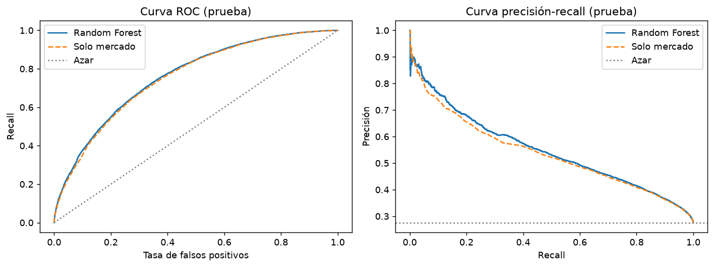
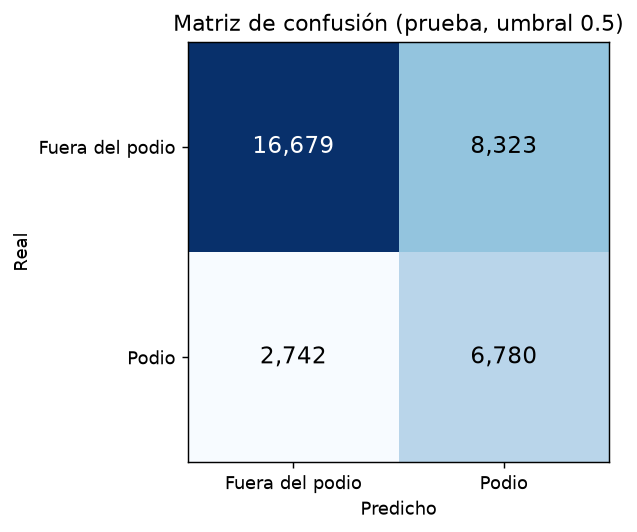
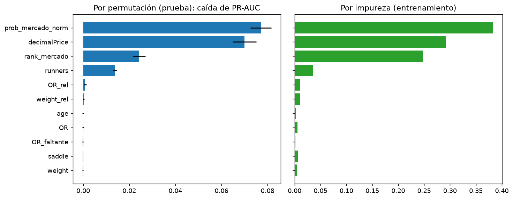
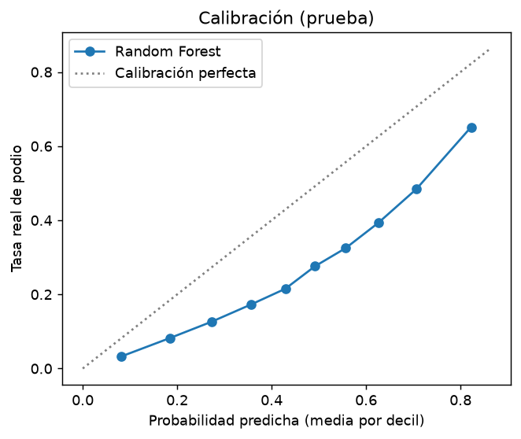
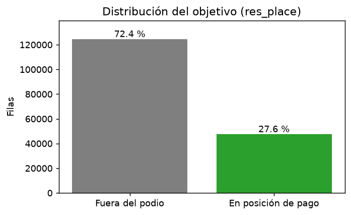
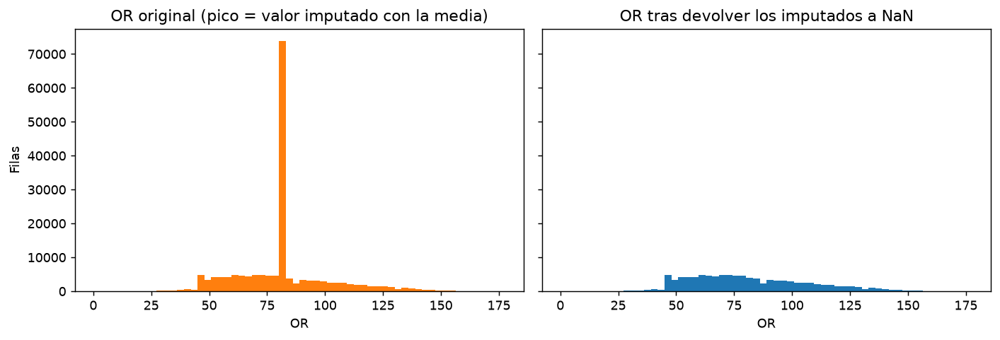
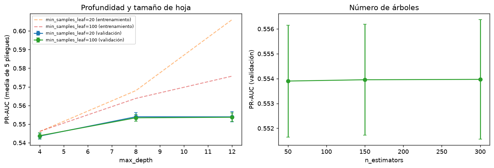

# EA2 - Regresión lineal y clasificación (Horse Race)

Analisis aplicado medio de Machine Learning - Institución Universitaria
Digital de Antioquia. Esta entrega contiene el código y los recursos
reproducibles de la actividad AE2: «Modelos de Predicción y Clasificación».

## Propósito y necesidad

Construir y comparar dos modelos de aprendizaje automático sobre el dataset de carreras de caballos mayacheruty/Horse-Race-Prediction-EDA de Hugging Face, de forma totalmente automática y reproducible:

   * Regresión lineal: estima el rating de desempeño de un caballo en una carrera (RPR, variable numérica).
   * Clasificación (regresión logística): predice si un caballo gana la carrera (res_win, clase binaria con solo un 10 % de positivos).

El trabajo responde a tres necesidades:

   1. Datos confiables. El dataset publicado trae casi la mitad de los ratings OR y un 11 % de los RPR rellenados con la media. Detectarlos y revertirlos, evitar variables que revelan el resultado de la carrera y dividir por carrera sin mezclar caballos entre entrenamiento y prueba evita métricas infladas.
   2. Evaluación honesta con clases desbalanceadas. Con un 10 % de ganadores, la exactitud engaña: responder siempre “no ganó” acierta el 90 %. Por eso el clasificador se evalúa con precisión, recall, F1, PR-AUC y matriz de confusión.
   3. Trazabilidad. Cada ejecución deja un reporte generado por código, con dataset, preprocesamiento, parámetros, métricas, interpretación y limitaciones, y un historial de commits automáticos que documenta los resultados de cada versión.

El flujo descarga los datos, los preprocesa, entrena y evalúa cada modelo, interpreta los resultados y genera un resumen .txt con ambos modelos. Todo se ejecuta sin cargar archivos a mano y se repite en GitHub Actions con cada cambio.

**Orientación del dataset:** 

Presenta un análisis exploratorio de datos (EDA) exhaustivo de un conjunto de datos sobre carreras de caballos de 2019 que contiene más de 171.849 registros. El objetivo era identificar los principales factores biológicos, profesionales y de mercado que determinan un resultado ganador.

## Integrantes

- Juan Felipe Valencia Renteria
- Diego Alejandro Barros Ballestas

## Dataset

- **Identificador:** `mayacheruty/Horse-Race-Prediction-EDA`
- **Enlace:** <[(https://huggingface.co/datasets/mayacheruty/Horse-Race-Prediction-EDA)](https://huggingface.co/datasets/mayacheruty/Horse-Race-Prediction-EDA)>
- **Split:** `train` (dataset completo; no es muestra)
- **Licencia declarada en la ficha oficial de Hugging Face:** Apache 2.0 (`apache-2.0`), verificada el 2026-10-26.
- **Datos sintéticos:** pendiente de verificar en la ficha; no se encontró una declaración explícita.
- **Autenticación:** Se describe en la sección correspondiente a "EA1 - Carga y Creación de Dataset"

El notebook descarga el dataset mediante `datasets` al ejecutarse y lo convierte
a un DataFrame de pandas. No se versiona una copia CSV; Hugging Face conserva la
caché local de la descarga. La licencia indicada corresponde a los metadatos de
la [ficha oficial](https://huggingface.co/datasets/mayacheruty/Horse-Race-Prediction-EDA).

# EA1 - Carga y Creación de Dataset

Repositorio de referencia: un notebook ejecutable por clase que deja un resumen `.txt` en `reportes/`.

## Comandos de Uso

```bash
cd /workspaces/ML_2026_IUD
python -m venv .venv
source .venv/bin/activate
python -m pip install --upgrade pip
pip install -r requirements.txt
pip install pyarrow openpyxl  # opcional: parquet y xlsx
python scripts/build_notebooks.py   # opcional: regenerar notebooks
jupyter lab
```

En Bash, el entorno virtual debe activarse con `source` (o con un punto):

```bash
source .venv/bin/activate
# equivalente:
. .venv/bin/activate
```

No se debe ejecutar `.venv/bin/activate` directamente, porque `activate` es
un script que modifica la sesión actual de la terminal. Cuando se activa
correctamente, el prompt muestra `(.venv)`.

Cada notebook termina con `report.save()`, que escribe `reportes/<carpeta>/<notebook>.txt`.

## Autenticación en Hugging Face

Para descargar datasets públicos normalmente no se necesita un token. Si el
dataset es privado o requiere aceptación de condiciones de uso, configura un
token de Hugging Face siguiendo estos pasos.

### 1. Crear un token

1. Inicia sesión en [Hugging Face](https://huggingface.co/).
2. Abre [Settings > Access Tokens](https://huggingface.co/settings/tokens).
3. Selecciona **Create new token**.
4. Asigna un nombre descriptivo, por ejemplo `RP_AD2026Q4`.
5. Selecciona el permiso mínimo necesario: **Read**.
6. Presiona **Create token** y copia el token. Normalmente comienza por
   `hf_`.

Guarda el token de forma segura y no lo incluyas en el código fuente.

### 2. Instalar la CLI e iniciar sesión

Con el entorno virtual activado, instala o actualiza la librería de Hugging
Face:

```bash
python -m pip install --upgrade huggingface_hub
```

Inicia sesión desde la terminal:

```bash
hf auth login
```

Cuando la terminal solicite el token, pégalo y presiona **Enter**. Es normal
que no se muestren caracteres mientras lo escribes o pegas.

La sesión queda guardada localmente para que `HFDatasetLoader` pueda usarla
automáticamente. Comprueba que la autenticación funcionó:

```bash
hf auth whoami
```

Si tu instalación usa la CLI antigua, el comando equivalente es:

```bash
huggingface-cli login
```

### 3. Cargar el dataset autenticado

Después de iniciar sesión, no es necesario pasar el token al constructor:

```python
from rp_utils import HFDatasetLoader

loader = HFDatasetLoader(
    "Fast_Food_Restaurants",
    filename="datos/fast_food.csv",
)
df = loader.load()
```

No escribas tokens directamente en archivos Python ni los subas a GitHub.
Si un token se expone accidentalmente, revócalo desde [Access
Tokens](https://huggingface.co/settings/tokens) y crea uno nuevo.

## Carga de un dataset como DataFrame

`HFDatasetLoader` recibe el identificador del dataset, descarga la división
indicada y devuelve un `pandas.DataFrame`. `filename` y `file_type` son
opcionales; si se proporciona `filename`, el DataFrame también se guarda en
`csv`, `json`, `parquet` o `xlsx`.

```python
from rp_utils import HFDatasetLoader

loader = HFDatasetLoader(
    "Fast_Food_Restaurants",
    filename="datos/fast_food.csv",
)
df = loader.load()
```

Para ejecutar este ejemplo manualmente, crea un archivo `prueba_loader.py` en
la raíz del proyecto con el código anterior y ejecuta:

```bash
PYTHONPATH=src python prueba_loader.py
```

También se puede ejecutar directamente desde la terminal:

```bash
PYTHONPATH=src python -c '
from rp_utils import HFDatasetLoader

df = HFDatasetLoader(
    "Fast_Food_Restaurants",
    filename="datos/fast_food.csv",
).load()

print(df.head())
'
```

También se puede indicar el formato explícitamente:

```python
loader = HFDatasetLoader(
    "Fast_Food_Restaurants",
    filename="datos/fast_food",
    file_type="parquet",
)
df = loader.load()
```

## Documento de hallazgos EA3

<!-- HALLAZGOS_EA3:INICIO -->
_Generado automáticamente por la ejecución del 2026-11-08T22:45:48. No editar a mano: se reescribe en cada ejecución._

### Respuesta a la pregunta de negocio

> **¿Qué factores conocidos antes de la salida determinan que un caballo termine en posición de pago (podio), para que un analista de apuestas hípicas decida a qué caballos de cada carrera dar prioridad en sus apuestas de colocado?**

Sí es posible anticipar parcialmente qué caballos hacen podio. Los factores que más lo determinan son prob_mercado_norm, decimalPrice, rank_mercado. El modelo acierta 50,0 % de los 3 caballos que propone por carrera (azar: 27,6 %; favoritos del mercado: 50,9 %), por lo que sirve como apoyo para priorizar apuestas de colocado, pero no como garantía de acierto.

### Hallazgos principales

- En datos que el modelo no vio, ordena a los caballos con ROC-AUC 0,760 (0,5 sería azar) y PR-AUC 0,548 frente a 0,276 del azar.
- Con el umbral 0,50, de cada 100 caballos que marca como podio acierta 45 % (precisión) y detecta 71 % de los que realmente hacen podio (recall); F1 = 0,551.
- Matriz de confusión: 6.780 aciertos de podio. 8.323 falsas alarmas. 2.742 podios no detectados y 16.679 descartes correctos.
- Dentro de cada carrera, de los 3 caballos mejor puntuados por el modelo el 50,0 % termina en podio; con los 3 favoritos del mercado es 50,9 % y al azar 27,6 %.
- El modelo casi no mejora al mercado solo (ROC-AUC 0,754 frente a 0,760): el precio ya resume casi toda la información disponible.
- Entre entrenamiento y prueba la PR-AUC pasa de 0,566 a 0,548 (diferencia pequeña: no hay sobreajuste importante).
- Variables que más pesan (por permutación): prob_mercado_norm (41,4 %), decimalPrice (37,6 %), rank_mercado (13,0 %).

| Métrica | Entrenamiento | Prueba |
|---|---:|---:|
| Precisión | 0,458 | 0,449 |
| Recall | 0,721 | 0,712 |
| F1 | 0,560 | 0,551 |
| ROC-AUC | 0,771 | 0,760 |
| PR-AUC | 0,566 | 0,548 |







**Qué variables pesan:**

| Variable | Peso relativo (%) | Caída de PR-AUC al desordenarla |
|---|---:|---:|
| `prob_mercado_norm` | 41,4 | 0,0771 |
| `decimalPrice` | 37,6 | 0,0700 |
| `rank_mercado` | 13,0 | 0,0243 |
| `runners` | 7,4 | 0,0138 |
| `OR_rel` | 0,5 | 0,0009 |
| `weight_rel` | 0,1 | 0,0002 |
| `age` | 0,0 | 0,0000 |
| `OR` | 0,0 | -0,0000 |
| `OR_faltante` | 0,0 | -0,0002 |
| `saddle` | 0,0 | -0,0002 |
| `weight` | 0,0 | -0,0002 |



### Qué tan confiables son los resultados y sus limitaciones



- Solo usa información previa a la carrera y disponible en el dataset (2019): no incluye estado del terreno, distancia de la carrera, forma reciente del caballo ni historial del jinete o del entrenador.
- Un 41 % de los ratings OR venía imputado con la media por el autor del dataset; se devolvieron a nulo y se rellenaron con la mediana del entrenamiento, por lo que el rating es menos informativo de lo que sería con datos completos.
- La precisión con el umbral 0,50 es 45 %: el 55 % de los caballos señalados no hace podio. Una apuesta basada en el modelo sigue teniendo alto riesgo de pérdida.
- Las probabilidades no están perfectamente calibradas: la mayor diferencia entre lo predicho y lo real por decil es de 23,3 puntos porcentuales (el modelo usa class_weight='balanced', que infla las probabilidades de la clase positiva). Úsense para ordenar, no como probabilidad literal.
- El resultado depende de la partición de carreras elegida (semilla 42); con otra partición las métricas variarían ligeramente.
- El modelo no considera cuotas finales de pago ni costos de apuesta: no mide rentabilidad, solo qué tan bien identifica a quienes hacen podio.
- El desempeño cambia según el tamaño del campo; es más débil en carreras de 16+ corredores.

### Recomendaciones

1. Usar el modelo para **ordenar** a los caballos dentro de cada carrera y revisar primero a los 3 mejor puntuados, en lugar de decidir con un umbral fijo de probabilidad.
2. No abandonar la regla simple de los 3 favoritos del mercado solo por este modelo: su ventaja por carrera es mínima (50,0 % vs 50,9 %). Úsese como segunda opinión.
3. Fuera del mercado, vigilar primero **runners**, la variable no-mercado con más peso en el modelo.
4. Antes de arriesgar dinero real, probar el modelo con carreras de otra temporada y medir la rentabilidad con cuotas reales; este análisis solo mide aciertos de podio.
5. Mejorar los datos: completar el rating OR sin imputar y añadir terreno, distancia de la carrera y forma reciente.

### Evidencia del preprocesamiento y del modelo







<!-- HALLAZGOS_EA3:FIN -->
