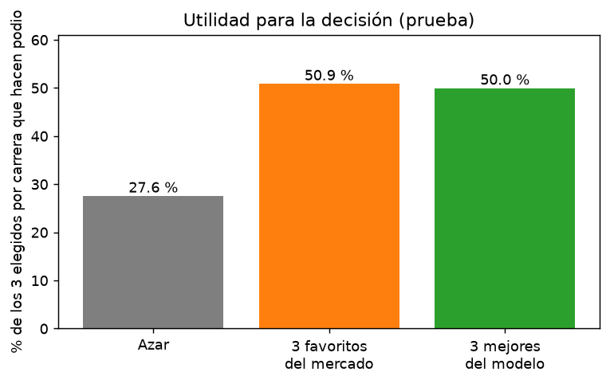
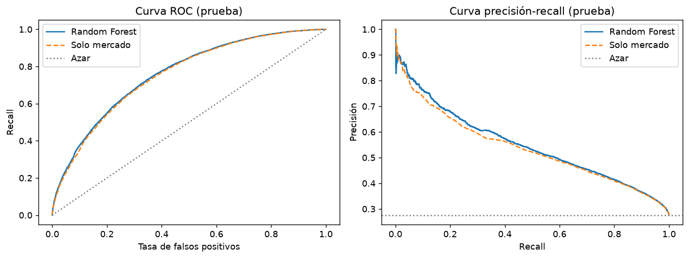
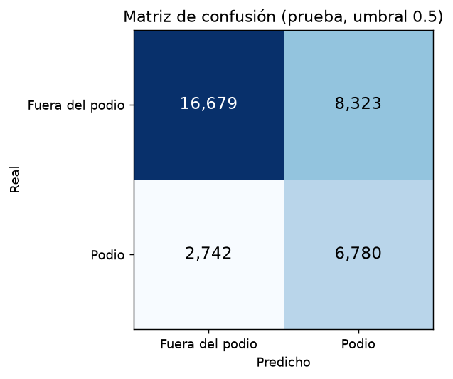
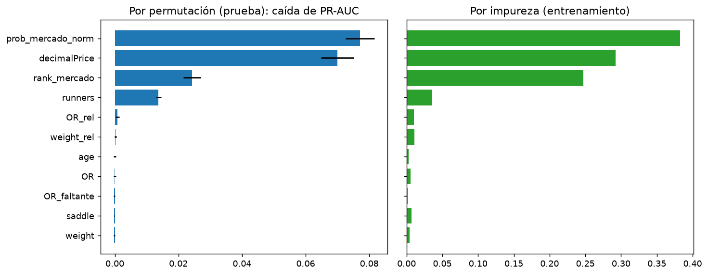
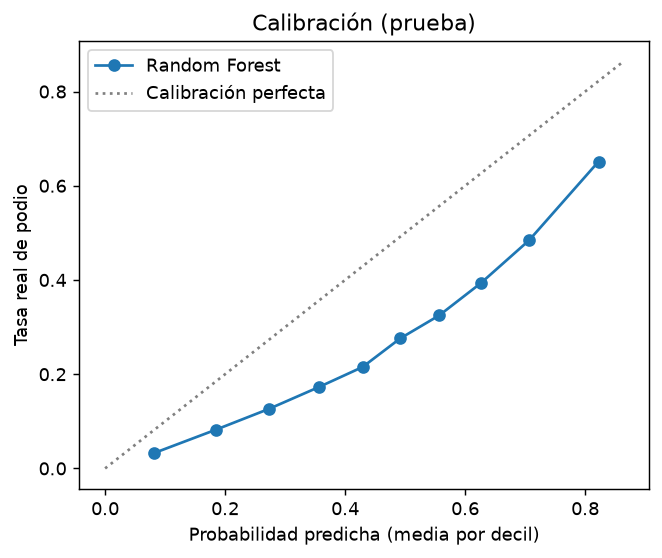
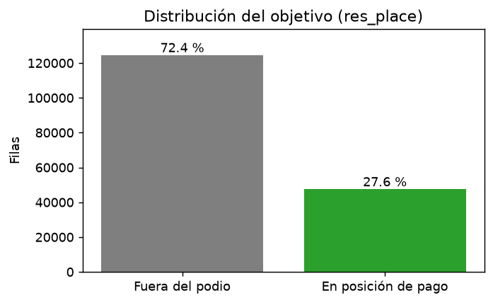
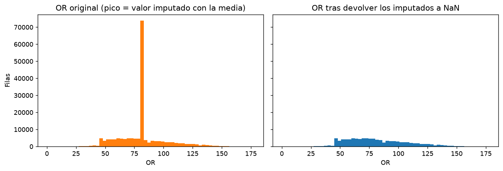
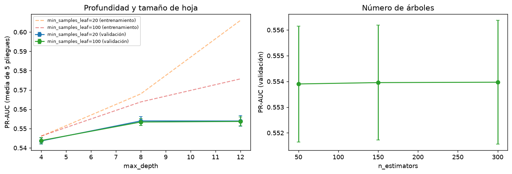

_Generado automáticamente por la ejecución del 2026-11-08T23:44:13. No editar a mano: se reescribe en cada ejecución._

### Respuesta a la pregunta de negocio

> **¿Qué factores conocidos antes de la salida determinan que un caballo termine en posición de pago (podio), para que un analista de apuestas hípicas decida a qué caballos de cada carrera dar prioridad en sus apuestas de colocado?**

Sí es posible anticipar parcialmente qué caballos hacen podio. Los factores que más lo determinan son prob_mercado_norm, decimalPrice, rank_mercado. El modelo acierta 50,0 % de los 3 caballos que propone por carrera (azar: 27,6 %; favoritos del mercado: 50,9 %), por lo que sirve como apoyo para priorizar apuestas de colocado, pero no como garantía de acierto.

### Hallazgos principales

- En datos que el modelo no vio, ordena a los caballos con ROC-AUC 0,760 (0,5 sería azar) y PR-AUC 0,548 frente a 0,276 del azar.
- Con el umbral 0,50, de cada 100 caballos que marca como podio acierta 45 % (precisión) y detecta 71 % de los que realmente hacen podio (recall); F1 = 0,551.
- Matriz de confusión: 6.780 aciertos de podio. 8.323 falsas alarmas. 2.742 podios no detectados y 16.679 descartes correctos.
- Dentro de cada carrera, de los 3 caballos mejor puntuados por el modelo el 50,0 % termina en podio; con los 3 favoritos del mercado es 50,9 % y al azar 27,6 %.
- El modelo casi no mejora al mercado solo (ROC-AUC 0,754 frente a 0,760): el precio ya resume casi toda la información disponible.
- Entre entrenamiento y prueba la PR-AUC pasa de 0,566 a 0,548 (diferencia pequeña: no hay sobreajuste importante).
- Variables que más pesan (por permutación): prob_mercado_norm (41,4 %), decimalPrice (37,6 %), rank_mercado (13,0 %).

| Métrica | Entrenamiento | Prueba |
|---|---:|---:|
| Precisión | 0,458 | 0,449 |
| Recall | 0,721 | 0,712 |
| F1 | 0,560 | 0,551 |
| ROC-AUC | 0,771 | 0,760 |
| PR-AUC | 0,566 | 0,548 |

**Qué variables pesan:**

| Variable | Peso relativo (%) | Caída de PR-AUC al desordenarla |
|---|---:|---:|
| `prob_mercado_norm` | 41,4 | 0,0771 |
| `decimalPrice` | 37,6 | 0,0700 |
| `rank_mercado` | 13,0 | 0,0243 |
| `runners` | 7,4 | 0,0138 |
| `OR_rel` | 0,5 | 0,0009 |
| `weight_rel` | 0,1 | 0,0002 |
| `age` | 0,0 | 0,0000 |
| `OR` | 0,0 | -0,0000 |
| `OR_faltante` | 0,0 | -0,0002 |
| `saddle` | 0,0 | -0,0002 |
| `weight` | 0,0 | -0,0002 |

### Qué tan confiables son los resultados y sus limitaciones

- Solo usa información previa a la carrera y disponible en el dataset (2019): no incluye estado del terreno, distancia de la carrera, forma reciente del caballo ni historial del jinete o del entrenador.
- Un 41 % de los ratings OR venía imputado con la media por el autor del dataset; se devolvieron a nulo y se rellenaron con la mediana del entrenamiento, por lo que el rating es menos informativo de lo que sería con datos completos.
- La precisión con el umbral 0,50 es 45 %: el 55 % de los caballos señalados no hace podio. Una apuesta basada en el modelo sigue teniendo alto riesgo de pérdida.
- Las probabilidades no están perfectamente calibradas: la mayor diferencia entre lo predicho y lo real por decil es de 23,3 puntos porcentuales (el modelo usa class_weight='balanced', que infla las probabilidades de la clase positiva). Úsense para ordenar, no como probabilidad literal.
- El resultado depende de la partición de carreras elegida (semilla 42); con otra partición las métricas variarían ligeramente.
- El modelo no considera cuotas finales de pago ni costos de apuesta: no mide rentabilidad, solo qué tan bien identifica a quienes hacen podio.
- El desempeño cambia según el tamaño del campo; es más débil en carreras de 16+ corredores.

### Recomendaciones

1. Usar el modelo para **ordenar** a los caballos dentro de cada carrera y revisar primero a los 3 mejor puntuados, en lugar de decidir con un umbral fijo de probabilidad.
2. No abandonar la regla simple de los 3 favoritos del mercado solo por este modelo: su ventaja por carrera es mínima (50,0 % vs 50,9 %). Úsese como segunda opinión.
3. Fuera del mercado, vigilar primero **runners**, la variable no-mercado con más peso en el modelo.
4. Antes de arriesgar dinero real, probar el modelo con carreras de otra temporada y medir la rentabilidad con cuotas reales; este análisis solo mide aciertos de podio.
5. Mejorar los datos: completar el rating OR sin imputar y añadir terreno, distancia de la carrera y forma reciente.

### Evidencia del preprocesamiento y del modelo

